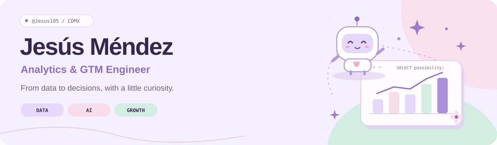

<picture>
  <source media="(prefers-color-scheme: dark)" srcset="assets/header-dark.svg">
  <source media="(prefers-color-scheme: light)" srcset="assets/header-light.svg">
  
</picture>

  
  &nbsp;
  
  &nbsp;
  

### Hola, I'm Jesús 🤖

I'm an **Analytics Engineer at Mercado Libre**, based in Mexico City. I work where **data engineering, commercial strategy, and applied AI** meet: turning raw data into reliable models, useful insights, and tools that make work easier.

My background spans dimensional modeling, conversion funnels, revenue planning, and autonomous analytics agents. Here, I'm sharing personal projects and experiments around the same things I enjoy building at work.

**Open to Analytics Engineering, GTM Engineering, and AI Automation opportunities.**

### A little impact, a lot of curiosity ✨

<table>
  <tr>
    <td align="center" width="33%"><h3>+20%</h3>Conversion lift in targeted categories</td>
    <td align="center" width="33%"><h3>90%</h3>Manual reporting workflows eliminated with AI</td>
    <td align="center" width="33%"><h3>10+</h3>Commercial verticals analyzed</td>
  </tr>
</table>

Highlights from my work at Mercado Libre.

### My toolkit 🧰

| Area | What I work with |
| :--- | :--- |
| **Data & analytics** | SQL · BigQuery · dimensional modeling · dbt / Dataform · ETL/ELT · Looker Studio · Tableau |
| **Software & automation** | Python · Git · CI/CD · REST APIs · Docker · Linux · n8n |
| **Applied AI** | LLM orchestration · autonomous agents · RAG · time-series forecasting with Prophet |
| **Commercial strategy** | Revenue management · P&L · unit economics · conversion funnels · GMV / AOV / CAC / LTV |

### Selected projects

**[Deal Signals & SDR Copilot](https://github.com/Jesus105/clara_app)** · `GTM` `AI` `Python`

A personal GTM demo that turns lead data and commercial signals into evidence-backed insights and AI email drafts, with human review, a persistent task queue, and an audit trail. Slack and HubSpot integrations are simulated.

**[Big Data Lab](https://github.com/Jesus105/bigdata)** · `PySpark` `Data engineering`

A collection of practical experiments with Spark DataFrames, missing data, filtering, and aggregation.

**[ML & Deep Learning](https://github.com/Jesus105/ML-DL)** · `Machine learning` `Jupyter`

Educational notebooks and experiments exploring machine learning and deep learning.

### Year in code

<a href="https://github.com/Jesus105?tab=overview">
  <picture>
    <source media="(prefers-color-scheme: dark)" srcset="https://raw.githubusercontent.com/Jesus105/Jesus105/profile-assets/contributions-dark.svg">
    <source media="(prefers-color-scheme: light)" srcset="https://raw.githubusercontent.com/Jesus105/Jesus105/profile-assets/contributions-light.svg">
    
  </picture>
</a>

A little progress, one square at a time. Click the calendar to explore my activity on GitHub.

### Next in the workshop ☁️

A personal AI agent inspired by Hermes, plus more projects connecting **data → decisions → action**. I'll share the code and what I learn along the way.

  
<b>A few milestones 🎓</b>

  - **B.S. in Artificial Intelligence Engineering** — ESCOM, Instituto Politécnico Nacional · 2025
  - **Winner, Hackathon4Justice 2019** — World Bank · Washington, D.C.
  - **Winner, EXPO CIUDADELA** — Fundación Politécnico
  - **Languages:** Spanish (native) · English (professional working proficiency)

---

Built with curiosity, a little SQL, and mucho cariño ♡

